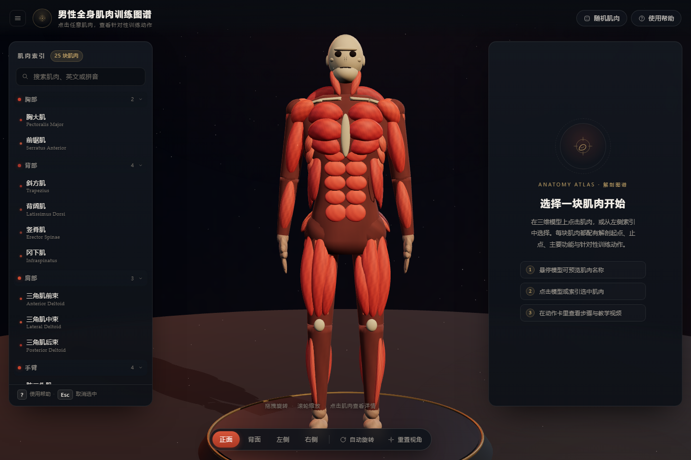
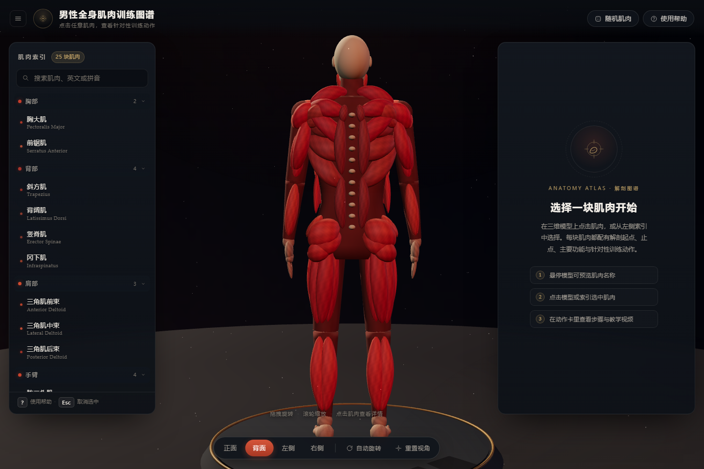
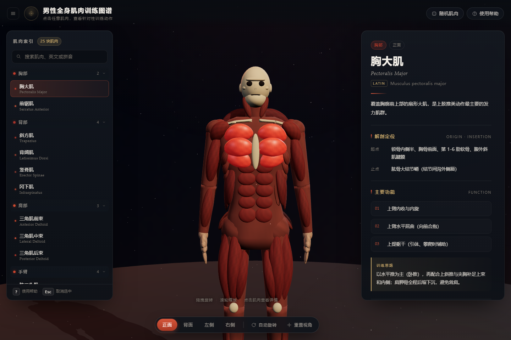

# 男性全身肌肉训练图谱 · Muscle Atlas

一个**可交互的三维男性肌肉解剖模型**：点击任意一块肌肉，右侧弹出它的解剖定位（起点 / 止点）、
主要功能，以及 3–4 个针对性的训练动作（器械、难度、组次、休息、步骤、提示、替代动作）。

纯静态网页，**双击 `index.html` 即可离线运行**，不需要安装、不需要本地服务器、不联网也能用。







---

## 1. 功能

| 功能 | 说明 |
| --- | --- |
| 三维肌肉模型 | 25 块肌肉 / 25 个交互 ID，程序化建模的 écorché（解剖雕塑）风格人体，深色展厅 + 金色底座 |
| 点击查看 | 点击肌肉 → 相机平滑聚焦 → 该肌肉高亮、其余变暗 → 右侧详情面板 |
| 训练动作库 | 86 个训练动作（大肌群 4 个 / 小肌群 3 个），每个动作含器械、难度、组次、休息、目标、3–4 步动作要领、2 条提示、替代动作 |
| 悬停预览 | 鼠标悬停显示中文名 / 英文名 / 左右侧，模型实时高亮 |
| 肌肉索引 | 左侧按「胸部 / 背部 / 肩部 / 手臂 / 核心 / 臀部 / 腿部 / 颈部」分组，支持中文名、英文名、拼音搜索 |
| 视角控制 | 正面 / 背面 / 左侧 / 右侧一键切换（球面补间，相机绕身体转而不是穿模）、自动旋转、重置视角 |
| 深链接 | `index.html#m=pectoralis-major&view=front` 直接打开某块肌肉；`#view=back` 直接进入背面 |
| 随机肌肉 | 不知道练哪？点「随机肌肉」 |
| 快捷键 | `Esc` 取消选中 / 关闭弹窗，`?` 打开帮助，`/` 或 `Ctrl+K` 聚焦搜索框，`R` 随机，`1–4` 切换视角 |
| 响应式 | 桌面三栏，窄屏左右面板变抽屉；移动端可用 |
| 无障碍 | 侧栏按钮可键盘操作、详情面板 `aria-live`、模型 `role="img"` 有中文描述 |
| 离线 | three.js 与 OrbitControls 已本地化到 `vendor/`，零外链（训练动作卡里的「B 站搜索」是可选的外链按钮，点了才联网） |

### 鼠标 / 触屏操作

- **左键拖拽**旋转 · **滚轮**缩放 · **点击肌肉**选中
- 点击空白处或按 `Esc` 取消选中
- 选中后再次点击同一块肌肉不会重复聚焦

---

## 2. 打开方式

1. **双击 `index.html`**（或双击 `打开.cmd`）。
2. 推荐最新版 Edge / Chrome / Firefox，并确认浏览器开启了硬件加速（WebGL）。

> 如果页面显示「无法启动 3D 模型」，说明浏览器没有拿到 WebGL 上下文：
> 请更新浏览器、开启硬件加速，或换一台机器试试。

无需 `npm install`、无需构建、无需起服务器——所有脚本都是经典 `<script>`，本地文件协议下直接可跑。

---

## 3. 部署到公网（可选）

如果想把图谱做成**可分享的网址**（发给朋友 / 手机直接打开），把 `deploy/` 目录上传到任意静态托管即可，
完整步骤见 **[docs/deploy-guide.md](docs/deploy-guide.md)**（含 GitHub Pages / Netlify / Vercel / Cloudflare Pages 四套方案与自检清单）。

```bat
python tools\build_deploy.py
```

会生成：

- `deploy/` —— 可直接上传的站点根目录（`index.html` + `styles.css` + `src/` + `vendor/` + 托管配置）
- `muscle-atlas-deploy.zip` —— 同内容的 zip，可直接拖到 Netlify Drop（<https://app.netlify.com/drop>）一键上线

说明：项目用 `#hash` 路由，托管到任何子路径（如 `https://用户名.github.io/muscle-atlas/`）都能直接用，
不需要配置 rewrite / SPA fallback。

---

## 4. 目录结构

```
muscle-atlas/
├─ index.html                 页面骨架（左侧索引 / 中间画布 / 右侧详情 / 底部视角条）
├─ styles.css                 深色展厅主题样式（含响应式抽屉、动效、无障碍焦点样式）
├─ 打开.cmd                   Windows 一键打开
├─ README.md
├─ vendor/
│  ├─ three.min.js            three.js r140（UMD 经典脚本，本地化，MIT）
│  └─ OrbitControls.js        three.js r140 examples/js/OrbitControls（经典脚本，MIT）
├─ src/
│  ├─ data/
│  │  ├─ muscles.js           25 块肌肉的中英/拉丁名、分组、颜色、功能简介、起点止点、三视图信息
│  │  └─ exercises.js         86 个训练动作（按肌肉 ID 索引）
│  └─ js/
│     ├─ body.js              程序化人体：躯干/四肢体块、骨骼点缀、头颅、手脚、25 块肌肉网格
│     ├─ engine.js            three.js 引擎：渲染、灯光、环境、拾取（射线）、相机补间、高亮状态机
│     ├─ ui.js                界面层：侧栏/搜索/详情面板/训练卡/哈希路由/快捷键/帮助弹窗
│     └─ main.js              启动入口：创建引擎 → 初始化 UI → 就绪后收起 loading
├─ tools/                     开发辅助脚本（交付运行不需要）
│  ├─ build_deploy.py         生成 deploy/ 发布目录与 muscle-atlas-deploy.zip
│  ├─ deploy-templates/       Netlify / Vercel / GitHub Pages 托管配置模板
│  ├─ export_geometry.js      把 three.js 场景导出成 JSON，供 Python 软件渲染预览
│  ├─ render_preview.py       纯 numpy/Pillow 软件光栅化预览（无浏览器时检查造型）
│  ├─ make_selftest.py        生成 _selftest.html：无头浏览器里的 35 项交互自测
│  ├─ verify_run.js           CDP 驱动无头 Edge：跑自测 / 按状态等待后截图（真实时间，不受虚拟时钟影响）
│  └─ check_pick.js           Node 侧复现射线拾取，排查「点不中」问题
├─ docs/
│  ├─ github-references.md    GitHub 现成项目调研（10 个候选核实 + 许可证 + 借鉴结论）
│  └─ deploy-guide.md         公网部署指南（GitHub Pages / Netlify / Vercel / Cloudflare Pages）
├─ deploy/                    发布目录（由 build_deploy.py 生成，可直接上传静态托管）
├─ muscle-atlas-deploy.zip    发布包 zip（拖到 Netlify Drop 即可上线）
└─ shots/                     截图（README 用）与自测输出
```

脚本加载顺序（`index.html` 底部，必须保持）：

```
vendor/three.min.js → vendor/OrbitControls.js →
src/data/muscles.js → src/data/exercises.js →
src/js/body.js → src/js/engine.js → src/js/ui.js → src/js/main.js
```

---

## 5. 数据说明

### 肌肉数据 `src/data/muscles.js`

```js
window.MUSCLE_ATLAS.muscles = [{
  id: 'pectoralis-major',       // 唯一 ID，模型 / 动作库 / 哈希路由都用它
  name: '胸大肌', nameEn: 'Pectoralis Major',
  latin: 'Musculus pectoralis major', pinyin: 'xiong da ji',
  group: 'chest',               // chest / back / shoulder / arms / core / glutes / legs / neck
  color: '#c33d2b',             // 三维模型中的肌肉颜色
  views: ['front'],             // 主要可见视角，用于提示
  summary: '……',                // 一句话功能简介
  origin: '……', insertion: '……',// 起点 / 止点
  duties: ['……', '……', '……'],   // 3 条主要功能
  training: '……'                // 训练思路
}]
```

### 动作数据 `src/data/exercises.js`

```js
window.MUSCLE_EXERCISES = {
  'pectoralis-major': {
    exercises: [{
      name: '杠铃卧推', nameEn: 'Barbell Bench Press',
      equipment: '杠铃', difficulty: 2,      // 1 入门 / 2 进阶 / 3 高阶
      sets: '4 组 × 6–10 次', rest: '90–120 秒',
      target: '胸大肌中部',                  // 主要刺激部位
      steps: ['……', '……', '……'],           // 3–4 步
      tips: ['……', '……'],                  // 2 条提示
      alt: '哑铃卧推 / 上斜卧推'             // 替代动作
    }]
  }
}
```

- 25 个肌肉 ID、86 个动作，全部中文自写，未直接拷贝第三方数据集。
- 动作卡里的「在 B 站搜索教学视频」按钮只是 `https://search.bilibili.com/all?keyword=动作名` 外链，
  不点击不联网；离线打开时其余功能完全正常。

---

## 6. 实现要点

- **零依赖、零构建**：three.js r140 的 UMD 版本 + 经典 `<script>`，`file://` 下可直接运行
  （ESM + importmap 在 `file://` 会被 CORS 拦，故刻意不用）。
- **程序化人体**：不用任何第三方模型/贴图。躯干用超椭圆截面环、四肢用变半径管、
  肌肉用「沿中心线变半径的椭球截面管（strand）」+ 椭球（腹直肌、三角肌等）拼出，
  顶点色做肌纤维条纹；每块肌肉是独立 `MeshStandardMaterial`，便于高亮 / 变暗。
- **拾取**：`THREE.Raycaster` 只对 `body.interactive`（25 块肌肉的 128 个网格）做射线检测，
  命中后取 `mesh.userData.muscleId`；用 pointerdown→pointerup 的位移阈值区分「点击」与「拖拽旋转」。
- **高亮状态机**：idle / hover / selected / dim 四态，选中时其余肌肉 color×0.26 + roughness 提高，
  选中肌肉 emissive 脉冲呼吸（选中态的 `emissiveIntensity` 由渲染循环驱动）。
- **相机**：OrbitControls（禁平移、阻尼）+ 球面插值补间；切换视角时按方位角/仰角/半径插值，
  相机沿弧线绕身体转，避免直线穿过模型。
- **颜色管理**：`THREE.ColorManagement.legacyMode = false` + `outputEncoding = sRGBEncoding`
  + ACESFilmicToneMapping，否则十六进制颜色会被当线性值、整场景发灰发白。
- **哈希路由**：`#m=<muscleId>&view=<front|back|left|right>`，可前进/后退、可直接分享定位。
- **性能**：约 12.6 万三角形、215 个网格，PC 与主流手机可 60fps；`prefers-reduced-motion`
  下自动关闭自动旋转。

---

## 7. 验证记录

开发环境无图形界面，验证分三层：

1. **语法 / 数据**：`node --check` 全部通过；数据断言 25 个 ID、86 个动作、每个 ID 3–4 个动作。
2. **软件渲染**：`tools/render_preview.py` 用 numpy/Pillow 把导出的几何光栅化成正面/背面/三分之四视图，
   用于检查造型比例（无浏览器时的主要视觉手段）。
3. **真实浏览器无头自测**：`tools/make_selftest.py` 生成 `_selftest.html`，由 `tools/verify_run.js`
   用 CDP（Chrome DevTools Protocol）驱动无头 Edge 跑 35 项断言（模型就绪、数据完整、列表渲染、
   点击选中、详情面板、B 站链接、哈希路由、视角按钮、搜索（含拼音）、画布射线拾取、空白点击取消、
   随机、自动旋转、帮助弹窗、Esc、运行时错误），当前结果 **35/35 全部通过**，运行时 0 错误。
   截图见 `shots/screenshot-*.png`（`screenshot-hover.png` 为悬停提示，`selftest.png` 为自测面板）。

复跑方式（Windows，需要本机 Edge）：

```bat
python tools\make_selftest.py
node tools\verify_run.js --url "file:///.../muscle-atlas/_selftest.html" ^
  --shot shots\selftest.png --wait "window.__selftestDone===true" ^
  --report "JSON.stringify({summary:window.__selftestSummary})"
```

---

## 8. GitHub 调研结论（详见 `docs/github-references.md`）

- 3D 网页版肌肉图谱（`free-muscles`、`hpfrei/body-anatomy-3d-viewer`、`kilnwire/Anatomy`、
  `authorOd/3d-anatomy-atlas`、`buckypinkman/muscleview`）几乎全部绑定 **Z-Anatomy** 系的
  glb 模型（**CC BY-SA 4.0**，传染性、必须署名），且 `file://` 下无法 fetch 模型，必须起本地服务器。
- 2D 方案更易复用：`vulovix/body-muscles`（Apache-2.0，SVG，支持 UMD/`file://`）、
  `Jsplice/MuscleMap`（MIT，SVG + React）。
- 结论：为满足「授权干净 + 双击离线 + 可点击到每块肌肉」，本项目**自建程序化模型、自写中文数据**，
  不引入任何第三方模型 / 贴图；仅在交互设计上借鉴 raycast + `userData.muscleId` + 位移阈值、
  以及「非选中肌肉变暗」的聚焦方式。

## 9. 已知限制

- 模型是**风格化解剖示意**，不是医学级网格：肌肉形状为程序化近似，比例按审美调整；
  适合「看位置、点肌肉、查动作」，不适合解剖学测量。
- 覆盖 25 块主要肌肉（胸 / 背 / 肩 / 臂 / 核心 / 臀 / 腿 / 颈），不是全身每一块小肌肉。
- 训练动作是通用健身建议，不构成医疗或康复方案；有伤病史请咨询专业人士。
- 移动端首次渲染在低端设备上可能需要 1–2 秒。

## 10. 许可

- 代码、程序化模型、中文解剖与训练数据：本项目原创，可自由使用与修改。
- `vendor/three.min.js`、`vendor/OrbitControls.js`：three.js r140，MIT License。
- 未使用 Z-Anatomy / BodyParts3D 等第三方解剖数据或网格。
